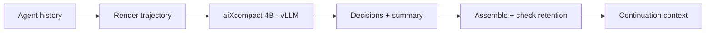
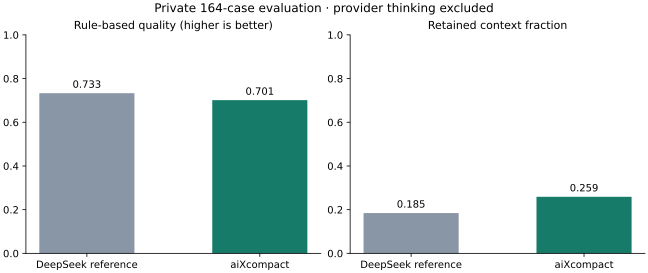

<div align="center">

# aiXcompact

### A smaller context. A clear path to the next step.

**A 4B context-compaction model and serving toolkit for coding agents, by aiXcoder.**

[中文](README.zh-CN.md) · [Quick Start](#quick-start) · [OpenCode](#opencode-integration) · [Results](#results) · [Documentation](#documentation)

</div>

Long-running coding agents accumulate file reads, tool results, and intermediate discussion. **aiXcompact** turns that history into a shorter continuation context: it selects which conversation items to retain, condenses tool results, and writes a handoff summary covering progress and unfinished work.

The repository provides the model-serving recipe, compaction service, examples, and version-pinned OpenCode/vLLM patches.

## Highlights

- **Structured compaction.** Per-item decisions—keep, remove, or replace a tool result—make the transformation inspectable.
- **Single-GPU serving.** A merged BF16 text model based on Qwen3.5-4B, validated on one A100 40GB per instance.
- **Agent integration.** OpenCode sends its history, system prompt, and tool definitions; the service returns messages ready for the next turn.
- **Operational controls.** Configurable target retention, deterministic fallback, request cancellation, and explicit processing statistics.

## How it works



The model produces a structured compression plan. The service applies it to the original messages while preserving tool-call/result pairing. If retention falls outside the configured band, the fallback reconstructs the context from the summary and recent message units.

See the [input/output specification](docs/protocol-and-data.md) and [service behavior](docs/service.md), including the case where a summary alone exceeds the target budget.

## Quick start

**Prerequisites:** Linux with Docker and NVIDIA Container Toolkit for model serving; Python 3.12 for the service. Run the commands below from the repository root.

**Model weights:** [aiXcoder/aiXcompact-4B](https://huggingface.co/aiXcoder/aiXcompact-4B). Download the complete model directory and set `MODEL_PATH` to its local path. The weights are already merged; no LoRA merge is required. Keep the configuration and tokenizer files alongside the weights. See the [deployment guide](docs/deployment.md).

### 1. Install the service

```bash
python3.12 -m venv .venv
source .venv/bin/activate
pip install -e .
```

### 2. Start the model

```bash
export MODEL_PATH=/absolute/path/to/aiXcompact-4B

docker build -f deploy/Dockerfile.vllm -t aixcoder-compact-vllm:0.22.1 .
GPU_ID=0 DECODE_MODE=ngram bash deploy/start-vllm.sh
```

`docker build` starts from the official image `vllm/vllm-openai:v0.22.1`, applies this repository's vLLM patch, and produces `aixcoder-compact-vllm:0.22.1`. Cold startup includes weight loading and compilation. Wait for `curl --fail http://127.0.0.1:8000/health` to return successfully. Set `DECODE_MODE=standard` to disable speculation; the published measurements use ngram k=32.

**Patch and acceleration.** The patch supports aiXcompact's text-only weights and fixes GDN state handling during speculative decoding. ngram reuses matching context spans as draft candidates without an extra draft model. Accepted candidates can reduce decoding rounds; With ngram speculative decoding enabled, aiXcompact has a reference speedup of approximately **1.39×** over standard decoding. Actual gains vary with hardware, input/output content, and concurrency.

### 3. Compress a conversation

In a separate terminal, activate the environment and start the service:

```bash
source .venv/bin/activate
export MODEL_PATH=/absolute/path/to/aiXcompact-4B
COMPACTION_HOST=127.0.0.1 python -m service.main
```

Then call it with the bundled synthetic example:

```bash
curl --fail http://127.0.0.1:12003/compact \
  -H 'Content-Type: application/json' \
  --data-binary @examples/request.json
```

The response contains `data.messages` for the agent's next turn and `data.stats` for retention and fallback behavior. A Python client is also available:

```bash
python -m examples.demo
```

For authentication, containerized service deployment, offline installation, and shutdown commands, see the [deployment guide](docs/deployment.md).

## OpenCode integration

Apply the patch for **OpenCode 1.14.40**, following the [integration guide](docs/integration.md). Then add this configuration to `opencode.json`:

```json
{
  "compaction": {
    "service_url": "http://127.0.0.1:12003",
    "target_ratio_pct": 25
  }
}
```

Use `/compact` in the patched OpenCode. The adapter carries the returned messages into subsequent turns and forwards interruptions to the service. Omitting `service_url` preserves OpenCode's built-in compaction path.

`target_ratio_pct: 25` means **retain approximately 25%**, not remove 25%. The model's recommended range is 10–50 in increments of five.

## Results

On an internal held-out evaluation set, the release configuration retained **25.89% of context on average**—a **74.11% reduction**. See the [methodology](docs/evaluation.md).

| Metric | DeepSeek V4 Pro reference | aiXcompact |
|---|---:|---:|
| Rule-based quality score | 0.7332 | 0.7012 |
| Mean retained context | 18.46% | 25.89% |



**GPU cost comparison.** aiXcompact costs use measured request times and public GPU rental rates; DeepSeek V4 Pro costs use a public-throughput proxy scenario. The comparison depends on the stated workload and deployment assumptions.

The results use ngram k=32. A response that reached the output limit remains in the denominator. The dataset construction and split are private. Standard and ngram decoding did not produce identical greedy text in a synthetic check. The [full report](results/REPORT.md) contains aggregate results, guardrail behavior, and these limitations; [methodology](docs/evaluation.md) explains the metrics and cost assumptions.


## Documentation

| Start here | What it covers |
|---|---|
| [Deployment](docs/deployment.md) | Model serving, service configuration, offline setup |
| [Integrations](docs/integration.md) | OpenCode 1.14.40 and vLLM 0.22.1 patches, testing, rollback |
| [Protocol & data construction](docs/protocol-and-data.md) | Input/output format and how to prepare compatible data |
| [Service API](docs/service.md) | Retention, fallback, cancellation, debugging |
| [Results](results/REPORT.md) | Quality, runtime measurements, and cost scenarios |

## Development

```bash
pip install -e '.[test]'
python -m pytest -q
```

The included tests cover the compaction service and its model-stream handling. OpenCode patch tests and live-integration instructions are in the integration guide.

## License

aiXcompact code is licensed under [Apache-2.0](LICENSE). The OpenCode patch retains the upstream [MIT license](patches/LICENSE.opencode). See [NOTICE](NOTICE) for third-party attribution.
